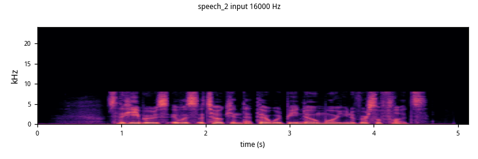
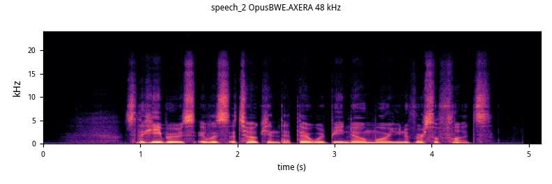
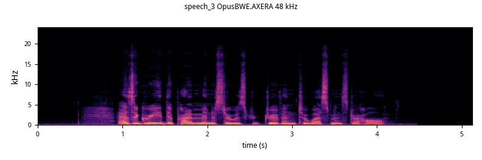
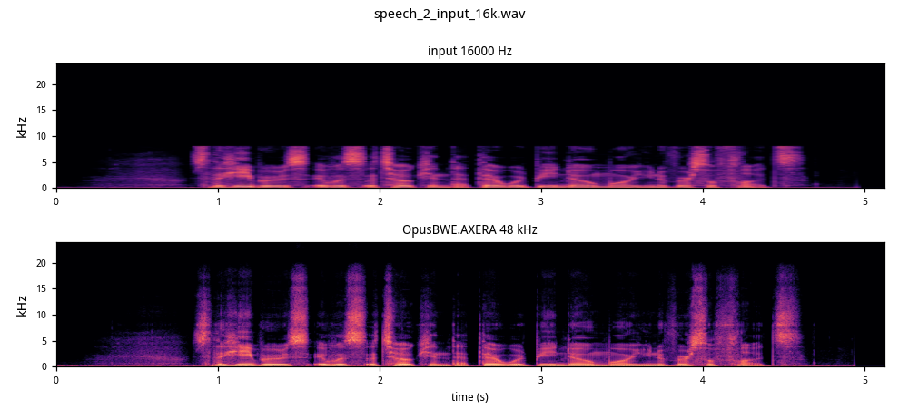

# OpusBWE.AXERA

**AX650 上的 16 kHz → 48 kHz 带宽扩展（Opus OSCE-BWE）。C++ 全链路 RTF 0.099（约 10× 实时）；axmodel 288 KB + C++ 可执行文件 2.3 MB，即取即用。**

   

- HuggingFace: https://huggingface.co/HY-2012/opusBWE.AXERA
- GitHub: https://github.com/ZY-2012/opusBWE.AXERA
- 上游: https://github.com/xiph/opus

> **说明**：上游 Opus 是完整编解码器（SILK/CELT/DRED/OSCE/LACE…），本仓库只抽取其中的
> **OSCE-BWE 带宽扩展**链路（`dnn/bwe_demo.c` / `osce_bwe()`）：16 kHz PCM 输入，
> 48 kHz PCM 输出。神经网络部分（feature net）量化后跑在 AX650 NPU 上，自适应滤波
> 合成留在 host（C，复用上游 Opus DSP）。

## 目录

- 快速开始
- 结果
- 推理速度
- 模型转换
- 数据来源
- License

## 快速开始（AX650 板端）

从 HuggingFace 下载 `models/`、`bin/`、`python/`、`samples/`，在包根目录运行：

```bash
# C++（默认）
bash run_ax650.sh samples/listen/16k/speech_2_input_16k.wav output.wav

# Python 封装
bash run_ax650.sh samples/listen/16k/speech_2_input_16k.wav output.wav --python
```

输入必须是 **16 kHz** wav，输出固定 48 kHz。

## 结果

| 版本 | 输入（16 kHz） | OpusBWE.AXERA 输出（48 kHz） |
|---|---|---|
| **speech_2** | [▶](https://cdn.jsdelivr.net/gh/ZY-2012/opusBWE.AXERA@main/samples/listen/16k/speech_2_input_16k.wav)<br> | [▶](https://cdn.jsdelivr.net/gh/ZY-2012/opusBWE.AXERA@main/samples/listen/48k/speech_2_output_48k.wav)<br> |
| **speech_3** | [▶](https://cdn.jsdelivr.net/gh/ZY-2012/opusBWE.AXERA@main/samples/listen/16k/speech_3_input_16k.wav)<br> | [▶](https://cdn.jsdelivr.net/gh/ZY-2012/opusBWE.AXERA@main/samples/listen/48k/speech_3_output_48k.wav)<br> |

### 16k → 48k 频谱对比（上：输入，下：输出）



## 推理速度：RTF

AX650（BSP V3.10.2），20 ms 一帧（320 → 960 点）：

| 链路 | RTF |
|---|---:|
| C++（NPU feature net + 上游 Opus DSP） | **0.099** |
| Python 封装（同上，subprocess 调用） | ≈ 0.10 |

- feature net（conv1/conv2/GRU/tconv）：288 KB axmodel，**1 次调用 / 10 ms 帧**；
- 自适应滤波（af1/af2/af3）、TDShaper、SILK 上采样：上游 Opus C DSP（BSD）。

## 模型转换

```bash
# 1) 下载上游权重（opus_data 包内 dnn/models/bbwenet_v2.pth）
#    https://media.xiph.org/opus/models/opus_data-a5177ec6fb7d15058e99e57029746100121f68e4890b1467d4094aa336b6013e.tar.gz
# 2) 导出 feature net（流式，1 帧/次）
python model_convert/export_feature_net.py --frames 1 --out export/bwe_feature_net_t1.onnx
# 3) 真实特征标定（必须用真实特征，随机噪声会裁波）
python model_convert/make_calib.py <wavs...>
# 4) Pulsar2 8.0 编译
pulsar2 build --config model_convert/pulsar2_config.json
```

量化：U16 激活 / S8 权重 / U16 输出，MinMax，真实特征标定。

## 数据来源

- 上游模型/代码：xiph/opus（BSD-3-Clause），OSCE-BWE 权重 `bbwenet_v2.pth`
- 16 kHz 示例：公开人声样例经 48k → 16k 降采样

## License

Apache-2.0（本仓库代码）。上游 Opus 及 OSCE-BWE 模型为 BSD-3-Clause。
